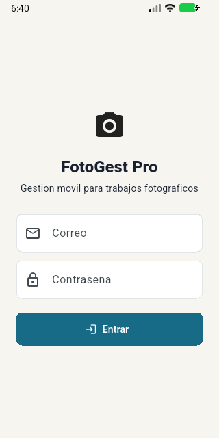
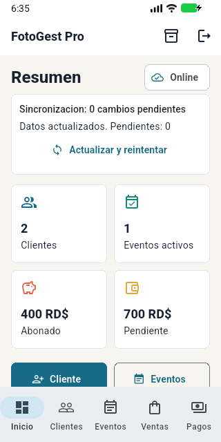
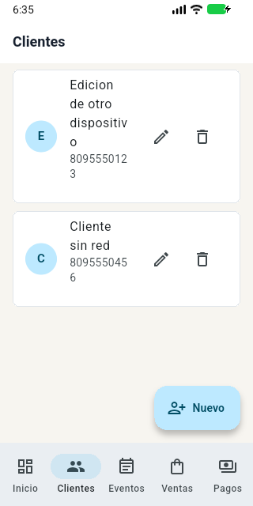
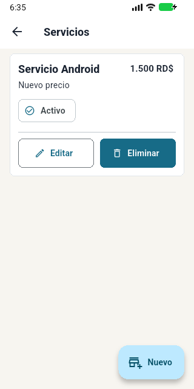
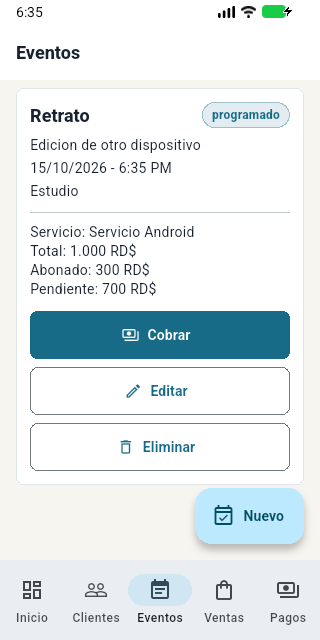
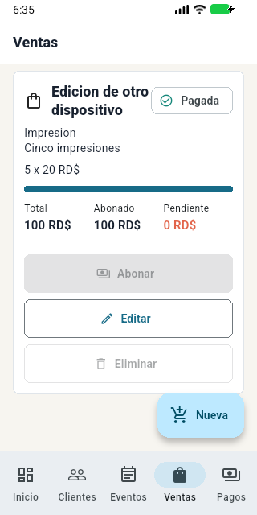
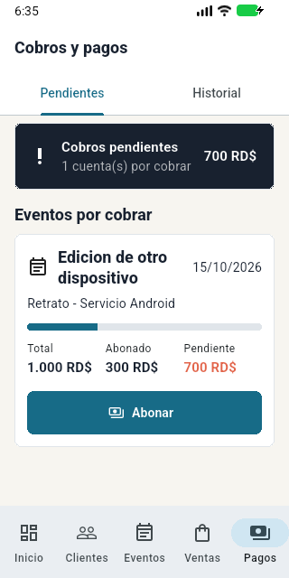

# Ficha del proyecto FotoGest Pro

FotoGest Pro es una aplicación Android para administrar la actividad comercial de fotógrafos independientes. Reúne clientes, servicios fotográficos, eventos, ventas, abonos y saldos, con información separada por cuenta y recuperación de cambios pendientes.

| Característica | Descripción |
| --- | --- |
| Autor | Edwin De Jesús Tavarez Minaya |
| Matrícula | 100053122 |
| Institución | Universidad Abierta para Adultos, UAPA |
| Asignatura | Seminario de Proyecto II, ISW411 |
| Facilitador | Ing. Henry Candelario |
| Versión | 1.1.0+3 |
| Plataforma | Android, API mínima 24 y objetivo 36 |
| Tecnologías | Flutter 3.44.4, Dart 3.12.2, Firebase Authentication y Cloud Firestore |
| Arquitectura | MVVM con ChangeNotifier, InheritedNotifier y repositorio de datos |
| Repositorio | [github.com/wdwintavarez01-lang/fotogest-pro](https://github.com/wdwintavarez01-lang/fotogest-pro) |

## Documentación

- [Informe final de las seis fases](FotoGest_Pro_Informe_Final_Seis_Fases.docx).
- [Manual de usuario](manual_usuario.md).
- [Documentación técnica](documentacion_tecnica.md).
- [Pruebas y cierre de la versión](cierre_1_1_0.md).
- [Preparación y compilación](../../README.md#preparación).

## Acceso y panel

La pantalla de acceso corresponde a la APK 1.1.0 instalada. El panel muestra los datos de ensayo de I01: RD$400 abonados, RD$700 pendientes y cero cambios pendientes después de recuperar la conexión.

  
  

## Clientes y servicios

Clientes permite consultar y administrar contactos. Servicios reúne el catálogo, los precios y la disponibilidad. La actualización del catálogo a RD$1,500 conserva el importe de RD$1,000 acordado en el evento existente.

  
  

## Eventos y ventas

El evento conserva RD$1,000 como total, RD$300 abonados y RD$700 pendientes. La venta de cinco impresiones a RD$20 muestra RD$100 pagados y saldo cero.

  
  

## Cobros y pagos

El módulo muestra las cuentas pendientes y permite consultar su total, el importe abonado y el saldo. Los pagos se confirman junto con el acumulado de la cuenta mediante una transacción y se conservan como historial.

Las seis capturas funcionales proceden del ensayo I01 en Android API 36.1, con datos de prueba en el proyecto local demo-fotogest. Los nombres y teléfonos visibles son datos de ensayo.
